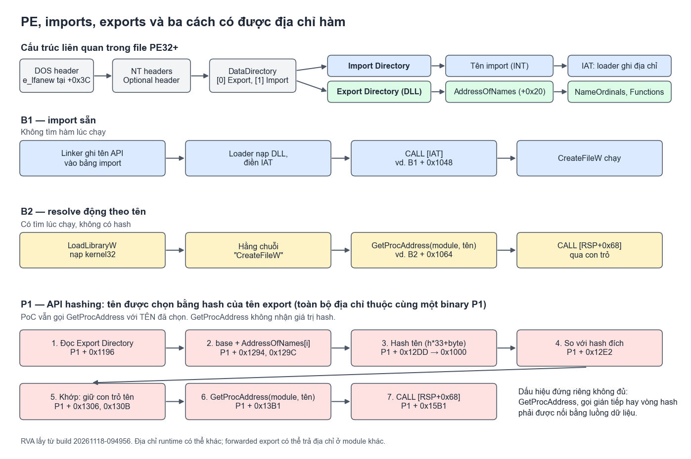

# Ghi chú PE: import, export và địa chỉ hàm

Tài liệu cho G1-TV2-01. Ví dụ địa chỉ thuộc build `20261118-094956`, image base tĩnh `0x140000000`.

## 1. Các loại địa chỉ

| Loại | Ý nghĩa | Ví dụ với P1 |
|---|---|---|
| File offset | Vị trí byte trong tệp | `0x7B1` |
| RVA | Khoảng cách từ đầu image đã nạp | `0x13B1` |
| VA tĩnh | Image base trong PE + RVA | `0x1400013B1` |
| VA runtime | Base thực tế lúc chạy + RVA | Không xác định bằng phân tích tĩnh |

Ghi bằng chứng theo dạng `module + RVA`, kèm SHA-256 của binary. Không so RVA giữa hai build khác nhau.

## 2. Các vùng dữ liệu liên quan

| Thành phần | Cách đi tới trong PE32+ | Vai trò |
|---|---|---|
| NT headers | `e_lfanew` tại DOS header `+0x3C` | Điểm vào các header chính |
| Export directory | NT headers `+0x88` là RVA, `+0x8C` là kích thước | Danh mục hàm DLL xuất ra |
| `NumberOfNames` | Export directory `+0x18` | Số tên export |
| `AddressOfFunctions` | Export directory `+0x1C` | Bảng RVA hàm |
| `AddressOfNames` | Export directory `+0x20` | Bảng RVA tên |
| `AddressOfNameOrdinals` | Export directory `+0x24` | Nối tên với chỉ số hàm |
| Import directory | DataDirectory `[1]` | Danh sách DLL và hàm cần nhập |
| IAT | Từ import descriptor | Các ô loader ghi địa chỉ hàm |

## 3. Import sẵn và tìm hàm lúc chạy

| | Import sẵn (B1) | Resolve theo tên (B2) | API hashing (P1) |
|---|---|---|---|
| Ai có địa chỉ | Loader điền IAT trước khi mã chạy | Chương trình hỏi `GetProcAddress` | Chương trình hỏi `GetProcAddress` sau khi tìm được tên |
| Tên API đích trong binary | Có trong dữ liệu import | Có dưới dạng chuỗi được mã tham chiếu | Không có trong P1 đã kiểm |
| Dạng gọi | `CALL [IAT]` | `CALL` qua con trỏ | `CALL` qua con trỏ |
| Dấu hiệu quyết định | Hàm nằm trong bảng import | Tên hằng đi vào `GetProcAddress` | Hash của tên export quyết định tên nào được dùng |

`CALL [IAT]` cũng là lệnh gọi gián tiếp về cú pháp. Vì vậy một lệnh gọi gián tiếp đứng riêng không chứng minh API hashing.

## 4. Những điều không được suy diễn

- Có `GetProcAddress` chỉ cho biết có khả năng resolve lúc chạy.
- `GetProcAddress` nhận tên hoặc ordinal, không nhận hash của PoC.
- Resolve theo tên chưa phải API hashing.
- Một vòng hash có thể chỉ xử lý dữ liệu, như `TV2C-B4` và `TV2C-B5`.
- Duyệt export chưa phải hashing, như `TV2C-B6` dùng `strcmp`.
- Forwarded export có thể làm địa chỉ trả về nằm ở module khác, nên không luôn lấy địa chỉ trừ base của `kernel32`.
- Binary có thể chứa import và chuỗi từ CRT. Không suy ra nội dung binary chỉ từ source.

## 5. Bằng chứng liên quan

- B1 và B2: `evidence/G1/TV2/G1-TV2-02/b1-b2-comparison.md`
- P1: `evidence/G1/TV2/G1-TV2-03/p1-evidence-chain.md`
- Danh sách dấu hiệu: [static-checklist.md](static-checklist.md)

Tài liệu tham khảo: [Microsoft PE format](https://learn.microsoft.com/en-us/windows/win32/debug/pe-format), [GetProcAddress](https://learn.microsoft.com/en-us/windows/win32/api/libloaderapi/nf-libloaderapi-getprocaddress).
